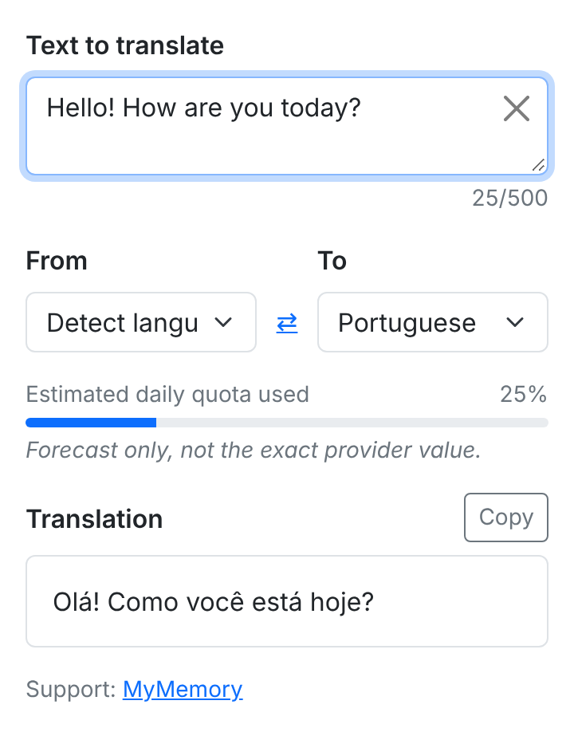
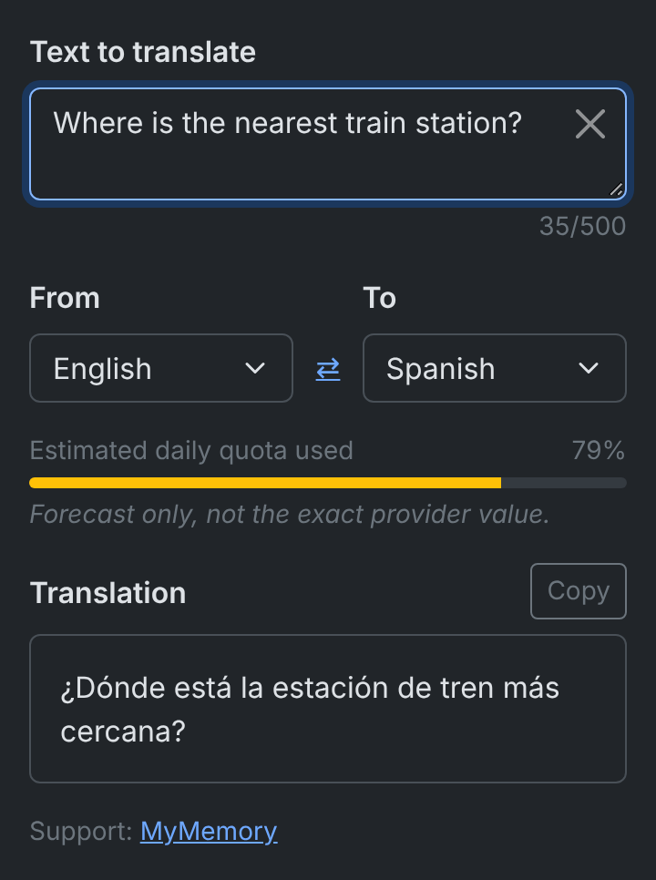

# Simple popup translator

An unofficial browser extension that translates text in its popup using the [MyMemory](https://mymemory.translated.net/) translation API. Not affiliated with MyMemory/Translated.

## Screenshots

| Light theme | Dark theme |
| :---: | :---: |
|  |  |

The popup follows the system's light or dark theme automatically.

## Why?

I wasn't finding any simple extension that just allowed me to use the translator on any page. All the ones I tested translated some selected text or didn't open the popup. So here we are with this extension.

## Project Description

This is a lightweight browser extension that provides quick access to translation functionality directly from your browser. Type or paste any text you want to translate, select your source and target languages, and get instant translations without leaving the current page.

### Key Features

- **Simple UI**: Clean and intuitive interface for easy translation
- **Language Swapping**: Quickly exchange source and target languages with one click
- **Auto-Detection**: Automatically detect the language of your input text
- **Last Translation Saved**: Your last text and its translation are still there when you reopen the popup
- **Copy to Clipboard**: Easily copy translated text with a single click
- **Theme Support**: Respects your system's light/dark mode preference
- **Multi-Language**: Full localization support for English, Spanish, and Portuguese

### User Interface Functions

The extension includes the following interface capabilities:

- **Source Text Input**: Enter or paste text to be translated with a visual textarea
- **Language Selection**: Dropdown selectors for both source and target languages, with auto-detection option
- **Language Swap**: Button to quickly reverse the translation direction
- **Translation Display**: Real-time display of translation results with loading feedback
- **Copy Button**: Copy translated text to clipboard with visual confirmation
- **Clear Button**: Clear input and reset the translation
- **Status Feedback**: Real-time status messages for errors and interactions
- **Theme Adaptation**: Automatically adjusts to system dark/light mode

## External Dependencies

This project uses the following external libraries and services:

- **Bootstrap CSS Framework**: Provides responsive design and UI components (bootstrap.min.css)
- **MyMemory Translation API**: Powers the translation functionality via `api.mymemory.translated.net`
- **Browser Extension APIs**: Uses native browser i18n and clipboard APIs

## Icon

The extension icon (`assets/icon.svg`) is original artwork made for this project from basic geometric shapes, with no fonts or third-party images, and is distributed under the same MIT License as the code. The PNG files in `assets/icons/` are exported from that SVG at 16, 32, 48 and 128 px.

## Privacy & Security

- **What is sent**: The text you type and the selected languages are sent to the MyMemory Translation API (`api.mymemory.translated.net`) to be translated. Nothing is sent while the text box is empty, and no other external service is called
- **What stays on your device**: Your last selected languages, your last text and its translation, and the daily usage estimate are kept only in the browser's local storage
- **No access to web pages**: The extension does not read, collect or modify the content of the pages you visit
- **No tracking**: No analytics, advertising or user accounts
- **No Background Activity**: The extension does not run any background processes or services
- **Open Source**: All code is available on GitHub for full transparency and community review

Avoid entering passwords or other sensitive information, since the text is processed by a third-party translation service. Read the full [Privacy Policy](PRIVACY.md).

## Repository

All source code is available on GitHub. Visit the repository to contribute, report issues, or review the implementation.

[GitHub Repository: olliveiragusttavo/translate-extension](https://github.com/olliveiragusttavo/translate-extension)
